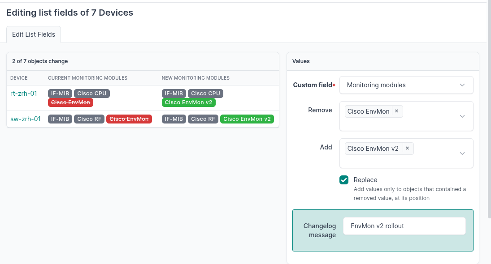
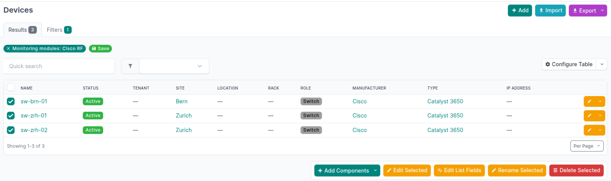
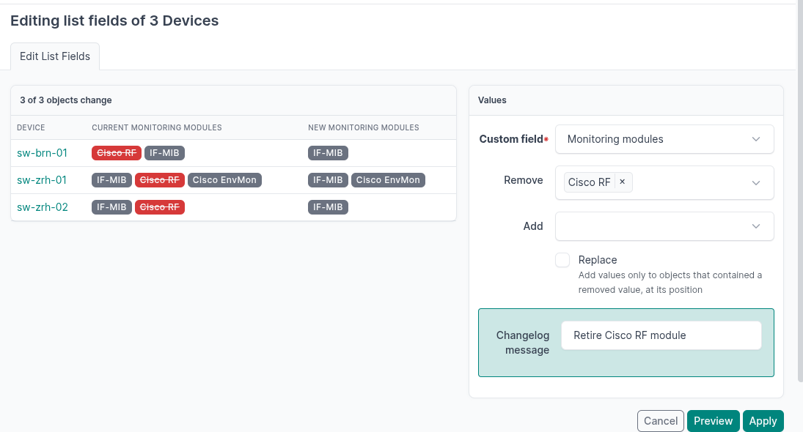

# netbox-list-edit

Bulk add, remove or replace single values in NetBox multi-select and multi-object custom fields.

NetBox bulk edit can only overwrite or clear these fields. Tags have *Add tags* / *Remove tags*, contacts got add/remove in bulk edit with [#23672](https://github.com/netbox-community/netbox/pull/23672), list custom fields have nothing comparable. This plugin fills that gap. We think it belongs in NetBox core and built it so it can move there; until then it is a plugin.



## Usage

Every object list whose model has a multi-select or multi-object custom field gets an **Edit List Fields** button next to *Edit Selected* / *Rename Selected*. It works for any model with custom fields, core and plugin models alike, and supports "select all N matching query".

1. Filter the list and select objects, e.g. `/dcim/devices/?device_type=catalyst-3650&cf_monitoring_modules=cisco_rf`
2. **Edit List Fields**, pick the custom field
3. Choose values to **Remove** and/or **Add**
4. **Preview** shows old → new per object, only for objects that change
5. **Apply**





| Operation | How |
|---|---|
| Add | Values in *Add*; objects that already have them are unchanged |
| Remove | Values in *Remove*; objects without them are unchanged |
| Replace | *Remove* old, *Add* new, tick **Replace**: only objects that had an old value get the new one, at the old value's position |

Removals run before additions. Order of the remaining values is kept, no duplicates are introduced, and a list that ends up empty is stored as null (like clearing it in bulk edit). For multi-select fields, *Remove* also offers values present on the selected objects that are no longer in the choice set.

To exclude objects, use the list filters, e.g. `tag__n=pinned`.

## Behaviour

- Permission: the regular *change* permission of the model. With constrained permissions, selected objects the user may not change are skipped and reported.
- Saved through the normal model save path: `full_clean()`, changelog (with optional message), event rules and webhooks.
- Changes are computed from the current values at *Apply* time, so edits made between preview and apply are not overwritten.
- Only custom fields with *UI editable* = Yes are offered.

## Install

```sh
pip install git+https://github.com/zebbra/netbox-list-edit.git@v0.1.0
```

```python
PLUGINS = ["netbox_list_edit"]
```

No configuration, no database migrations. Tested with NetBox 4.6.

## Development

```sh
cd dev
docker compose up -d     # http://localhost:8010, admin / admin, seeded devices and locations
docker compose exec netbox sh -c "/opt/netbox/venv/bin/python /opt/netbox/netbox/manage.py shell < /demo/smoke.py"
uvx pytest tests         # list logic, no NetBox needed
```

Code changes need `docker compose up -d --force-recreate netbox`. The smoke test runs end to end against devices and locations (multi-select and multi-object fields, select all, replace, permissions, changelog) and rolls back.
